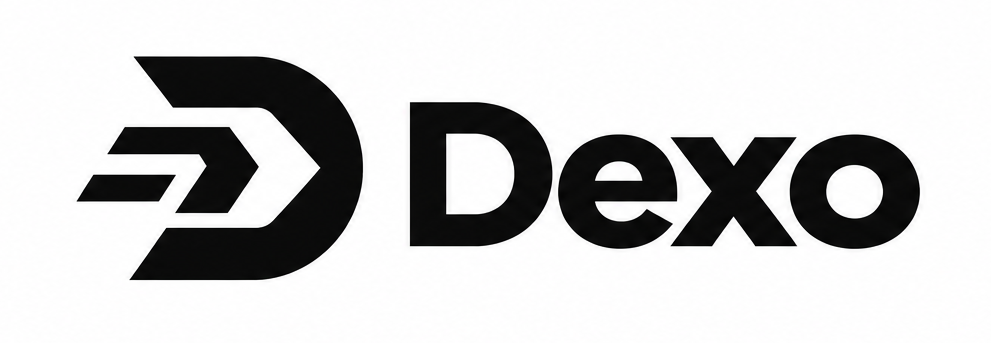

<div align="center">



<br />
<br />

# Dexo

**High-Performance Desktop Download Manager with IDM-Inspired Precision**

[](https://github.com/rimantmp/Dexo/releases)
[](https://github.com/rimantmp/Dexo)
[](https://tauri.app)
[](LICENSE)

</div>

---

## Overview

**Dexo** is a modern, lightweight desktop download manager built from the ground up as a native alternative to Internet Download Manager (IDM). Built on **Rust** and **Tauri 2**, Dexo combines an asynchronous multi-connection networking engine with a clean, high-density desktop interface and a companion browser extension.

Unlike traditional Electron-based download tools, Dexo utilizes minimal RAM and CPU while delivering maximum network throughput through parallel byte-range chunking.

---

## Key Capabilities

### Network & Engine
- **Multi-Stream Chunking**: Splits large files into up to 16 concurrent byte segments via Tokio asynchronous tasks.
- **Dynamic Byte Balancing**: Automatically allocates segment ranges without byte collisions or file fragmentation.
- **Pause and Resume**: Resumes interrupted transfers using HTTP Range headers (`bytes=x-y`) and ETag validation.
- **Automatic Fallback**: Gracefully defaults to single-stream download if the remote host does not support `Accept-Ranges`.
- **Preallocated Buffered I/O**: Preallocates target file size on disk to minimize storage fragmentation and reduce SSD write overhead.

### Desktop User Interface
- **High-Density Transfer Grid**: Data table displaying filename, size, speed, ETA, and progress bar with tabular numbers to prevent layout jitter.
- **Categorization Tree**: Automatic classification into Compressed, Documents, Music, Programs, and Video directories.
- **Action Toolbar**: Dedicated controls for Add URL, Resume, Stop, Stop All, Delete, Options, and Scheduler.
- **SQLite Persistence**: Transfer history, active segments, and custom settings are stored locally using SQLite with WAL (Write-Ahead Logging).

### Companion Browser Extension (Manifest V3)
- **Automatic Interception**: Intercepts matching file extensions from Chrome, Edge, Brave, and Opera.
- **Cloud Storage Support**: Handles dynamic redirects and session cookies for services like Google Drive, Dropbox, and Mediafire.
- **Media Sniffer Panel**: Floating download button on HTML5 video and audio streams.
- **Native Local Bridge**: Secure communication with the desktop application via local loopback (`127.0.0.1:4192`).

---

## Architecture

```
┌─────────────────────────────────────────────────────────────┐
│                    Svelte 5 Desktop UI                      │
│     (MenuBar, Action Toolbar, CategoryTree, TransferGrid)   │
└──────────────────────────────┬──────────────────────────────┘
                               │ Tauri 2 IPC
┌──────────────────────────────▼──────────────────────────────┐
│                    Tauri Host Application                   │
│         (System Tray, Local Bridge Server: 127.0.0.1:4192)  │
└──────────────┬──────────────────────────────┬───────────────┘
               │                              │
┌──────────────▼──────────────┐┌──────────────▼───────────────┐
│     SQLite Local Database   ││    Tokio Asynchronous Core   │
│   (Downloads, Logs, WAL)    ││   (HttpClient, Multi-chunk,  │
│                             ││    FileWriter, SegmentTrack) │
└─────────────────────────────┘└──────────────────────────────┘
```

---

## Browser Extension Setup

The companion extension is located in the [`browser-extension/`](browser-extension/) directory.

1. Open your Chromium-based browser (`chrome://extensions` or `edge://extensions`).
2. Enable **Developer mode** in the upper right corner.
3. Click **Load unpacked** and select the `browser-extension` folder.
4. *(Optional)* Run `browser-extension/native-host/install-host.bat` as Administrator to enable native messaging registration.

---

## Development & Building

### Prerequisites
- **Node.js** (v18.0 or higher)
- **Rust Toolchain** (1.75 or higher): Install from [rustup.rs](https://rustup.rs)
- **C++ Build Tools**: Visual Studio Build Tools with the *Desktop development with C++* workload

### Getting Started

```powershell
# 1. Clone repository
git clone https://github.com/rimantmp/Dexo.git
cd Dexo

# 2. Install frontend dependencies
npm install

# 3. Launch in development mode
npm run tauri dev
```

### Production Build

To build standalone Windows installers (`.exe` and `.msi`):

```powershell
npm run tauri build
```

Compiled installer binaries will be generated under `src-tauri/target/release/bundle/`.

---

## Automated Releases via GitHub Actions

Dexo includes an automated CI/CD pipeline ([`.github/workflows/release.yml`](.github/workflows/release.yml)). Pushing a version tag triggers a GitHub Actions runner that compiles the release binary and attaches the installer directly to GitHub Releases:

```powershell
git tag v0.1.0
git push origin v0.1.0
```

---

## Tech Stack

| Component | Technology | Purpose |
|---|---|---|
| **Core Engine** | Rust + Tokio | Async network socket management & file I/O |
| **HTTP Client** | Reqwest + Rustls | Fast HTTP/1.1 & HTTP/2 streaming |
| **Desktop Framework** | Tauri 2 | Native Windows webview shell |
| **User Interface** | Svelte 5 + Tailwind CSS | Reactive, lightweight desktop interface |
| **Database** | SQLite + Rusqlite | Local metadata & transfer history with WAL |
| **Browser Extension** | JavaScript (Manifest V3) | Download interception & media sniffing |

---

## License

This project is licensed under the [MIT License](LICENSE).
